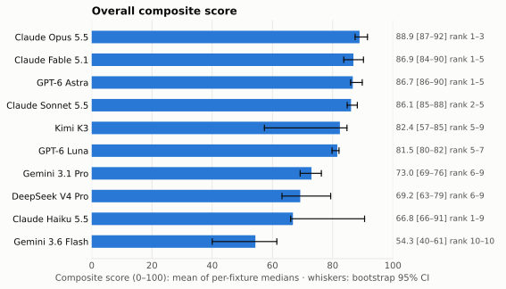
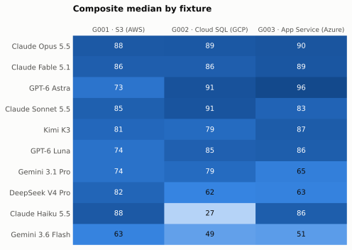
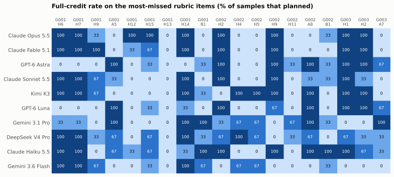
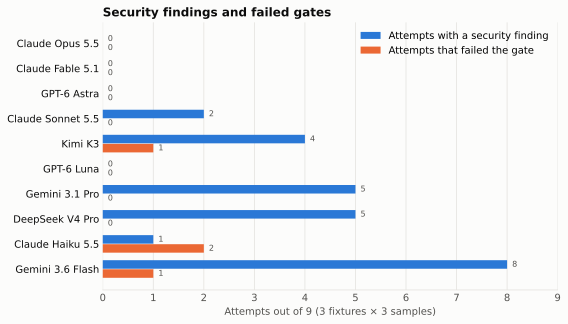
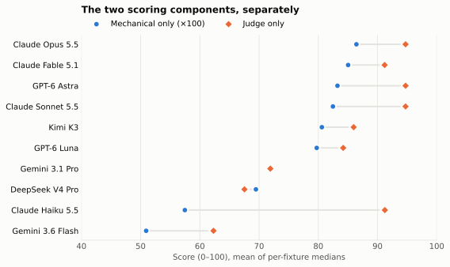
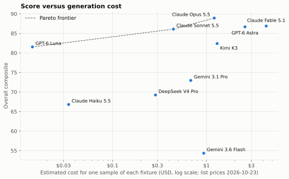

# How well do language models write infrastructure modules?

**iac-bench release 2026-10 · published 2026-10-23 · 10 models · 3 clouds · 90 attempts**

We asked ten language models to write reusable OpenTofu modules for three common cloud
services:

- an S3 bucket for application teams (AWS);
- a Cloud SQL for PostgreSQL instance for a DBA team (GCP);
- an App Service web app for an SRE team (Azure).

Each request was a few sentences long, as it would be from a colleague. It never listed
the security, durability or hygiene requirements a senior reviewer would expect.

We scored the 90 resulting modules on two components:

- **Mechanical rubric (70%).** Fixture-specific checks evaluated against real `tofu plan`
  output.
- **Judge (30%).** A calibrated LLM judge grading design and craft against a published
  quality doctrine.

This article reports the results and the patterns behind them:

- [Methodology](./methodology.md): how it was done.
- [Scoring criteria](./scoring-criteria.md): the reference for every criterion ID used
  below.
- [Per-model reports](#per-model-reports): one page per model.

## Key findings

1. **Four models form a top group:** Claude Opus 5.5 (88.9), Claude Fable 5.1, GPT-6 Astra and
   Claude Sonnet 5.5, all between 86.1 and 88.9.
   - All four have 95% rank intervals within 1–5. The models ranked below them reach fifth at
     best, except Claude Haiku 5.5, whose interval (1–9) is widened by two failed attempts.
   - Within the group, Claude Opus 5.5 is the most dependable: no failed gates, no security
     findings, and the best worst case in the field. Its weakest attempt scored 85.0. Its
     lead is not statistically decisive.
2. **Universal blind spots, regardless of vendor or rank:**
   - **S3 logging permission (G001 `H13`).** No attempt, out of 30, gave the S3 logging
     service permission to deliver access logs.
   - **Database drops (G002 `H11`).** 24 of the 28 Cloud SQL modules that planned drop a
     database's data when it is removed from the module's input.
   - **Provider version bounds (`B1`).** Constraints admitting the next major version
     appear in 19/30 AWS modules and 22/28 GCP modules. Only 2/28 Azure modules did this.
3. **Security failures come in two forms,** and different models fall into different ones.
   - 25 of 90 attempts failed a mandatory security item.
   - In 15, a security setting was exposed as a consumer input, usually with a safe default.
   - In the other 10, a setting the provider defaults insecurely was never set.
   - Four models had no security findings: Claude Opus 5.5, Claude Fable 5.1, GPT-6 Astra
     and GPT-6 Luna.
4. **The ranking does not depend on the LLM judge.** Ranked by the mechanical score alone, the
   ten models fall in exactly the same order as the composite. The judge reorders models
   only within its own component, and it catches defects the rubric cannot see (and the
   reverse).
5. **Cost buys little at the top.**
   - **Most expensive:** Claude Fable 5.1, at about $14 for nine attempts.
   - **Similar scores for less:** Claude Opus 5.5 ($3.58) and Claude Sonnet 5.5 ($1.52).
   - **Cheapest:** GPT-6 Luna scores 81.5 for five cents in total, with no security
     findings.
6. **Open weights trail the leaders but sit mid-field.**
   - Kimi K3 places fifth (82.4), ahead of GPT-6 Luna and Gemini 3.1 Pro.
   - DeepSeek V4 Pro places eighth.

## Leaderboard

| Rank | Model | Developer | Weights | Overall (95% CI) | Rank interval | G001 · S3 | G002 · Cloud SQL | G003 · App Service | ✗ gate | ⚠ security | Cost, 9 attempts |
|---|---|---|---|---|---|---|---|---|---|---|---|
| 1 | [Claude Opus 5.5](./models/claude-opus-5-5.md) | Anthropic | Closed | **88.9** (87.5–91.5) | 1–3 | 87.9 | 88.6 | 90.2 | 0/9 | 0/9 | $3.58 |
| 2 | [Claude Fable 5.1](./models/claude-fable-5-1.md) | Anthropic | Closed | **86.9** (83.7–90.2) | 1–5 | 85.6 | 85.6 | 89.5 | 0/9 | 0/9 | $13.97 |
| 3 | [GPT-6 Astra](./models/gpt-6-astra.md) | OpenAI | Closed | **86.7** (86.0–89.8) | 1–5 | 72.8 | 91.3 | 95.9 | 0/9 | 0/9 | $7.26 |
| 4 | [Claude Sonnet 5.5](./models/claude-sonnet-5-5.md) | Anthropic | Closed | **86.1** (84.8–88.2) | 2–5 | 84.8 | 90.6 | 82.8 | 0/9 | 2/9 | $1.52 |
| 5 | [Kimi K3](./models/kimi-k3.md) | Moonshot AI | Open | **82.4** (57.3–84.7) | 5–9 | 81.1 | 79.2 | 86.9 | 1/9 | 4/9 | $3.96 |
| 6 | [GPT-6 Luna](./models/gpt-6-luna.md) | OpenAI | Closed | **81.5** (79.8–82.1) | 5–7 | 74.3 | 84.5 | 85.7 | 0/9 | 0/9 | $0.05 |
| 7 | [Gemini 3.1 Pro](./models/gemini-3.1-pro-preview.md) | Google | Closed | **73.0** (69.2–76.2) | 6–9 | 74.2 | 79.3 | 65.4 | 0/9 | 5/9 | $2.26 |
| 8 | [DeepSeek V4 Pro](./models/deepseek-v4-pro-0813.md) | DeepSeek | Open | **69.2** (63.2–79.3) | 6–9 | 82.5 | 62.1 | 63.2 | 0/9 | 5/9 | $0.88 |
| 9 | [Claude Haiku 5.5](./models/claude-haiku-5-5.md) | Anthropic | Closed | **66.8** (66.1–90.6) | 1–9 | 87.8 | 26.8 | 85.7 | 2/9 | 1/9 | $0.11 |
| 10 | [Gemini 3.6 Flash](./models/gemini-3.6-flash.md) | Google | Closed | **54.3** (40.0–61.5) | 10–10 | 62.8 | 49.2 | 51.0 | 1/9 | 8/9 | $3.14 |

Composite = 0.70 × mechanical + 0.30 × judge. Fixture columns are medians of three attempts. ✗ = attempts whose module did not plan; ⚠ = attempts failing at least one mandatory security item. Costs are estimates at list prices on 2026-10-23 and exclude judging.



*Figure 1. Overall composite (mean of the three per-fixture medians). Whiskers show the
bootstrap 95% CI; the right-hand labels give the 95% rank interval.*

**How to read the ranking.** Three samples per model per fixture is enough to separate
groups but not neighbors:

- **Top group:** Claude Opus 5.5, Claude Fable 5.1, GPT-6 Astra and Claude Sonnet 5.5. Their rank intervals overlap.
- **Clearest separation:** Claude Opus 5.5 is the only model whose interval (1–3) stays
  within the top three.
- **Bottom:** Gemini 3.6 Flash ranks last in at least 95% of bootstrap draws.
- **Middle:** the remaining models overlap one another.

Claude Haiku 5.5's interval is the widest in the release. It is driven by one fixture where
two of three modules failed to plan. Pairwise win probabilities are in the data release.

## Results by fixture



*Figure 2. Median composite of three attempts, per model and fixture.*

| Fixture | Field median | Best median | Most-missed rubric item (attempts that planned) | Most-missed mandatory item |
|---|---|---|---|---|
| G001 · S3 | 81.8 | 87.9 (Claude Opus 5.5) | `H13` log delivery permitted: 30/30 missed | `H1` public access block: 6/30 |
| G002 · Cloud SQL | 82.2 | 91.3 (GPT-6 Astra) | `H11` databases dropped on removal: 24/28 | `H2` encrypted connections: 9/28 |
| G003 · App Service | 85.7 | 95.9 (GPT-6 Astra) | `A7` interface budget: 19/28 | `H2` basic-auth publishing: 10/28 |

Fixture scores are not interchangeable. **G001 (S3)** punishes omission: the brief's
audience is developers who "don't know S3 well," so every hygiene decision falls to the
module. The models that lose the most here:

- GPT-6 Astra and GPT-6 Luna build secure but minimal buckets, with no lifecycle rules and
  no access logging. That costs them up to a quarter of the rubric.
- Gemini 3.6 Flash and DeepSeek V4 Pro expose the public access block as an input.

**G002 (Cloud SQL)** rewards locking down a specialist's interface without taking their
controls away. **G003 (App Service)** depends heavily on two settings the Azure provider
leaves insecure by default.

## Finding 1: The same blind spots, across vendors

Some criteria were missed by nearly every model, regardless of vendor, size or overall
rank. These are the clearest signal in the release, because they do not depend on which
model you pick.



*Figure 3. Share of attempts earning full credit on the rubric items most often missed,
by model. Item definitions are in [Scoring criteria](./scoring-criteria.md).*

These criteria were missed by most of the field.

**Access logs that cannot be delivered (G001 `H13`, 30/30 missed).**
- Nineteen S3 attempts offered no server access logging at all (`H9`).
- The rest point logging at a target bucket but never grant the S3 logging service
  permission to write to it, so S3 cannot deliver any logs.
- Every model, in every attempt, missed this.

**Databases dropped when removed from the input (G002 `H11`, 24/28 missed).**
- `google_sql_database` defaults to deleting the database, and its data, when the resource
  is removed.
- A DBA who removes a name from a module's `databases` list therefore drops that database's
  data on the next apply.
- Only GPT-6 Astra, Gemini 3.1 Pro and DeepSeek V4 Pro guarded against this, and only in
  some attempts, by setting `deletion_policy = "ABANDON"` or tying it to deletion
  protection.

**Backups that cannot be turned off (G002 `H4`/`H5`).** This one splits by rank:
- **The top models:** hardcode automated backups and point-in-time recovery to always on.
  That is safe, but it gives a DBA no way to skip backups on a disposable test instance, so
  it earns partial credit.
- **The full-credit attempts:** only Kimi K3, DeepSeek V4 Pro and the two Gemini models
  shipped backups on by default with a real opt-out.
- **Backups that outlive the instance:** no attempt kept automated backups after instance
  deletion (G002 `E1`, 0/28). By default Cloud SQL deletes them with the instance.

**Provider constraints that admit the next major version (`B1`).**

| Cloud | Attempts with such a constraint |
|---|---|
| AWS | 19/30 |
| GCP | 22/28 |
| Azure | 2/28 |

- **AWS and GCP:** the typical forms are an open-ended `>= 5.0`, or a window such as
  `>= 5.0, < 7.0` that spans two majors.
- **Azure:** modules almost always used `~> 4.0`.

The habit looks provider-specific rather than model-specific: the same models that bound
`azurerm` correctly left `aws` and `google` open.

**Expertise that only a few models showed:**
- **Cloud SQL login role** (`roles/cloudsql.instanceUser`, G002 `E6`): 13/28 granted it for
  the IAM database users they created. Without it, those users cannot log in.
- **Cloud SQL connection logging** (G002 `E8`): 12/28.
- **Key Vault references on App Service** (G003 `E5`): 6/28.

## Finding 2: Two ways to ship an insecure module



*Figure 4. Attempts with at least one mandatory security failure, and attempts that did
not plan, out of 9 per model.*

Each fixture has two **mandatory** items: its most severe security failures. Twenty-five of
90 attempts failed at least one.

| Pattern | Attempts | What it looks like | Models |
|---|---|---|---|
| **Secure default, open override** | 15 | The secure value is the default, but the setting is an input any consumer can change. For example, `ssl_mode` defaults to `ENCRYPTED_ONLY` while the validation also accepts `ALLOW_UNENCRYPTED_AND_ENCRYPTED`. | Gemini 3.6 Flash, Kimi K3, DeepSeek V4 Pro |
| **Insecure provider default left in place** | 10 | The module never sets the attribute, and the provider's default is insecure. On Azure, basic-auth publishing for FTP and Web Deploy is on unless disabled. | Gemini 3.1 Pro, Claude Sonnet 5.5, Claude Haiku 5.5, plus some attempts by DeepSeek V4 Pro and Gemini 3.6 Flash |

**Secure default, open override.** The doctrine treats this as a defect even when the
default is safe. A module's security posture has to hold for every consumer, and an input
that can silently weaken it will eventually be used to do so. Models in this pattern often
document the risk in the same breath: one description reads "Do not weaken this without a
security review" above a validation list that allows exactly that.

**Insecure provider default left in place.** This failure cannot be seen by reading the
source, because nothing is written down. The most-missed mandatory item in the release is
G003 `H2` (basic-auth publishing, 10/28). Several of these modules set HTTPS-only, TLS 1.2
and FTPS-off correctly in the same block, and still miss the two publishing flags the Azure
provider enables by default.

**Failed gates.** Four attempts produced modules that did not plan:
- **Two Claude Haiku 5.5 Cloud SQL attempts:** each looked up a network inside a
  placeholder project, saw `tofu plan` fail, and submitted anyway.
- **One Kimi K3 App Service attempt:** the deployment slot is missing a provider-required
  attribute.
- **One Gemini 3.6 Flash App Service attempt:** its outputs reference a resource that the
  module never declares.

## Finding 3: The rubric and the judge catch different defects, and the ranking holds without either



*Figure 5. Mechanical-only and judge-only scores per model (mean of per-fixture medians).*

**The ranking holds without the judge.** Ranked by the mechanical score alone, the ten models
fall in exactly the composite order. The judge's 30% shifts scores but never reorders the
leaderboard.

| Model | Mechanical only | Judge only | Composite rank |
|---|---|---|---|
| Claude Opus 5.5 | 86.4 (#1) | 94.7 (#1) | 1 |
| Claude Fable 5.1 | 85.0 (#2) | 91.2 (#5) | 2 |
| GPT-6 Astra | 83.2 (#3) | 94.7 (#2) | 3 |
| Claude Sonnet 5.5 | 82.5 (#4) | 94.7 (#3) | 4 |
| Kimi K3 | 80.6 (#5) | 86.0 (#6) | 5 |
| GPT-6 Luna | 79.7 (#6) | 84.2 (#7) | 6 |
| Gemini 3.1 Pro | 71.9 (#7) | 71.9 (#8) | 7 |
| DeepSeek V4 Pro | 69.5 (#8) | 67.5 (#9) | 8 |
| Claude Haiku 5.5 | 57.5 (#9) | 91.2 (#4) | 9 |
| Gemini 3.6 Flash | 50.9 (#10) | 62.3 (#10) | 10 |

The two components disagree on individual modules, and the disagreements are systematic.

**What the judge misses.** It reads source, so it cannot see:
- an insecure provider default that the source never mentions. It gave the App Service
  attempts with basic-auth findings full marks on *Anti-patterns* for their hardcoded
  HTTPS and TLS settings;
- a module that does not plan. It graded the four failed-gate modules between 50 and 89.5.

**What the rubric misses.** It checks planned outcomes, so it cannot see:
- whether documentation is true;
- whether an input is ever wired to anything;
- whether a collection input breaks the plan once it is populated.

The judge scored *Documentation* 0 in 26 of 90 attempts. It found, for example, a databases
input that fails as soon as one database is declared, which the rubric credited.

**Disagreement about restraint.** The largest single gap is GPT-6 Astra on S3:
- **Rubric:** about 64. It charges for every data-hygiene item missing from a bucket that
  never expires anything.
- **Judge:** 94.7. It credits the same bucket as restrained.

A reader who rejects the rubric's view can read the judge-only column, and the reverse.

**Self-preference.** The judge is Claude Opus 5.5. Claude models take three of the top four
judge-only ranks, alongside GPT-6 Astra. But the composite order, and Claude Opus 5.5's
first place, are identical under the mechanical score alone, where no model judges any
other.

## Finding 4: Cost and capability are only loosely related



*Figure 6. Overall composite against the estimated cost of one attempt at each fixture, at
list prices on 2026-10-23. The dashed line is the Pareto frontier: models no other model
beats on both cost and score.*

Generation cost varies by a factor of about 280 across the field, and it is only loosely
related to score.

| Model | Overall | Estimated cost, 9 attempts |
|---|---|---|
| GPT-6 Luna | 81.5 | $0.05 |
| Claude Haiku 5.5 | 66.8 | $0.11 |
| DeepSeek V4 Pro | 69.2 | $0.88 |
| Claude Sonnet 5.5 | 86.1 | $1.52 |
| Gemini 3.1 Pro | 73.0 | $2.26 |
| Gemini 3.6 Flash | 54.3 | $3.14 |
| Claude Opus 5.5 | 88.9 | $3.58 |
| Kimi K3 | 82.4 | $3.96 |
| GPT-6 Astra | 86.7 | $7.26 |
| Claude Fable 5.1 | 86.9 | $13.97 |

The Pareto frontier, the models no other model beats on both cost and score, runs through:
- **GPT-6 Luna:** the cheapest model with no security findings.
- **Claude Sonnet 5.5:** the cheapest model in the top group.
- **Claude Opus 5.5:** the highest score.

Claude Fable 5.1 costs about four times as much as Claude Opus 5.5 for a slightly lower
score. Claude Haiku 5.5 is the second-cheapest model and would sit near the frontier, but
for its two failed Cloud SQL attempts.

Costs are estimates: token counts multiplied by list prices. They exclude judging and any
provider-specific caching discounts beyond a flat cache-read and cache-write multiplier.

## Finding 5: Documentation is where good modules lose points

*Documentation* is the judged section most often scored 0: in 26 of 90 attempts. Nearly every
module has documentation. The zeros come from **documentation that is wrong**:
- a description that promises behavior the code does not implement;
- a stated limit that disagrees with the service;
- a comment contradicted by the line below it.

Under the doctrine, any wrong statement scores 0, however small.

| Pattern | Examples |
|---|---|
| Limits misstated | 1–35 days of WAL retention described for an edition that allows 1–7 |
| Inverted meaning | A deletion-protection input described as "whether or not to allow Terraform to destroy the instance" |
| Features that do not exist | "Least-requests load balancing" that is never configured; a staging-traffic input that feeds only an output |

**Longer documentation produces more of these errors.** The models that write long READMEs
(Claude Fable 5.1, GPT-6 Astra, Kimi K3) give the judge more claims to check:
- GPT-6 Astra had no zero.
- DeepSeek V4 Pro had six, one in every Cloud SQL and App Service attempt.
- Claude Haiku 5.5 had five.

## Finding 6: One sample is not enough

**The same model, prompt and fixture can produce very different modules.** Nine of the 30
model-fixture cells spread by more than 10 points across their three attempts. Four spread
by more than 20:

| Model · fixture | Range | Cause |
|---|---|---|
| Claude Haiku 5.5 · Cloud SQL | 25.3–91.0 | Two attempts did not plan |
| Kimi K3 · App Service | 25.3–89.4 | One attempt did not plan |
| Gemini 3.6 Flash · App Service | 15.0–62.4 | One attempt did not plan |
| DeepSeek V4 Pro · App Service | 57.8–81.8 | Basic-auth flags set in one attempt, absent in two |

Two consequences:
- **Single-sample leaderboards are fragile.** A single draw would have put Claude Haiku 5.5
  anywhere from first to ninth.
- **Consistency is itself a capability.** It separates the top group as much as peak
  quality does.

Every model in the top group has all three attempts within 11 points on every fixture.
Claude Opus 5.5's widest spread is 8.5 points.

## Per-model reports

- [Claude Opus 5.5](./models/claude-opus-5-5.md): 88.9 overall
- [Claude Fable 5.1](./models/claude-fable-5-1.md): 86.9 overall
- [GPT-6 Astra](./models/gpt-6-astra.md): 86.7 overall
- [Claude Sonnet 5.5](./models/claude-sonnet-5-5.md): 86.1 overall
- [Kimi K3](./models/kimi-k3.md): 82.4 overall
- [GPT-6 Luna](./models/gpt-6-luna.md): 81.5 overall
- [Gemini 3.1 Pro](./models/gemini-3.1-pro-preview.md): 73.0 overall
- [DeepSeek V4 Pro](./models/deepseek-v4-pro-0813.md): 69.2 overall
- [Claude Haiku 5.5](./models/claude-haiku-5-5.md): 66.8 overall
- [Gemini 3.6 Flash](./models/gemini-3.6-flash.md): 54.3 overall

## Limitations

The main limitations of this release:

- **Plan-only.** Nothing was applied, so errors that only appear at apply time are not
  measured.
- **Three fixtures.** Results should not be generalized beyond these three services.
- **Three attempts per cell.** Neighboring models usually cannot be separated.
- **Undated model aliases.** Results are tied to the run date (2026-10-22).
- **A single judge from the same vendor as four candidates.** Mitigated by calibration and
  by reporting the mechanical score alone, not eliminated.
- **An opinionated doctrine.** Massdriver, which builds infrastructure tooling, wrote the
  briefs, rubrics and doctrine.

Full discussion: [Methodology §8–9](./methodology.md#8-limitations).

## Data and reproduction

The data release contains:

- every eval log and transcript;
- all 90 generated modules;
- every judge grade, with its evidence;
- the calibration reviews;
- the computed statistics.

It is licensed CC BY 4.0. The evaluation code, fixtures, rubrics, reference modules and doctrine
are in the repository. Two scorer defects were found and fixed before publication; see
[Methodology §7](./methodology.md#7-errata-and-re-scoring).

## Citation

```bibtex
@misc{iacbench2026,
  title  = {iac-bench: Evaluating LLM-authored OpenTofu modules},
  author = {{Massdriver}},
  year   = {2026},
  month  = {10},
  note   = {Release 2026-10},
  url    = {https://github.com/massdriver-cloud/iac-bench}
}
```
